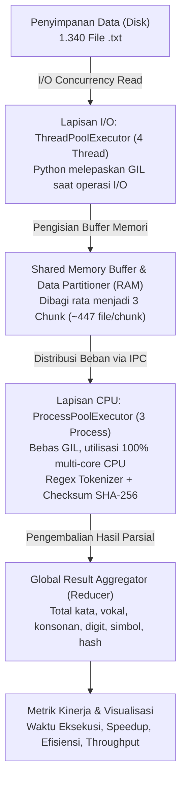

# Hybrid Computing: Parallel File Analyzer

Proyek Ujian Tengah Semester (UTS) mata kuliah **Komputasi Paralel dan Terdistribusi**  
Program Studi Informatika — Fakultas Teknik  

---

## 📌 Identitas Mahasiswa

| Informasi | Keterangan |
| :--- | :--- |
| **Nama** | Muhammad Zaki Zaidan Binawan |
| **NPM** | 247006111134 |
| **Kelas** | E |
| **Dosen Pengampu** | Randi Pro emergency / Pak Randi |
| **Mata Kuliah** | Komputasi Paralel dan Terdistribusi |

---

## 📖 Ringkasan Proyek

Proyek ini mengimplementasikan paradigma **Hybrid Computing** (kombinasi *Multithreading* dan *Multiprocessing*) dengan bahasa pemrograman Python untuk menganalisis karakteristik 1.340 file teks secara paralel dan terdistribusi pada *multi-core processor*.

### Mengapa Pendekatan Hybrid?
Python memiliki mekanisme **Global Interpreter Lock (GIL)** yang membatasi eksekusi *thread* secara konkuren murni hanya pada satu core prosesor untuk tugas CPU-bound. Untuk mengatasinya:
1. **Lapisan I/O (Thread-Level Concurrency):** Menggunakan `ThreadPoolExecutor` untuk membaca ratusan file dari media penyimpanan disk ke RAM secara asinkron. Python otomatis melepaskan GIL saat operasi disk I/O, sehingga thread sangat ringan dan hemat memori.
2. **Lapisan CPU (Process-Level Parallelism):** Menggunakan `ProcessPoolExecutor` untuk melakukan pemrosesan teks intensif (ekstraksi kata, penghitungan vokal/konsonan/simbol regex, dan checksum hash SHA-256). Setiap proses memiliki instance Python dan GIL independen sehingga komputasi berjalan secara paralel sejati (*true multi-core parallelism*).

---

## ⚙️ Parameter Konfigurasi (Berdasarkan NIM)

Sesuai dengan ketentuan soal UTS, parameter pengujian diturunkan secara langsung dari digit NIM **247006111134**:

| Parameter | Rumus Berdasarkan NIM | Nilai Konfigurasi |
| :--- | :--- | :--- |
| **Jumlah Thread** | `(Dua digit terakhir NIM mod 4) + 2` $\rightarrow$ `(34 mod 4) + 2` | **4 Thread** |
| **Jumlah Process** | `(Dua digit tengah NIM mod 3) + 2` $\rightarrow$ `(61 mod 3) + 2` | **3 Process** |
| **Jumlah Data/Task** | `Tiga digit terakhir NIM × 10` $\rightarrow$ `134 × 10` | **1.340 File Teks** |

---

## 📁 Struktur Direktori

```text
UTS/
├── 247006111134_M Zaki Zaidan B_UTS.pdf     # Dokumen Laporan Lengkap UTS
├── Presentasi_UTS_KPT_Zaki.pptx             # Slide Presentasi PPTX (Times New Roman)
├── Soal UTS Komputasi Paralel...pdf         # Panduan & Soal Tugas UTS
├── README.md                                # Dokumentasi Utama Proyek
└── UTS_KPT/                                 # Direktori Source Code & Eksperimen
    ├── DA_Hybrid.png                        # Diagram Arsitektur Hybrid Computing
    ├── generate_dataset.py                  # Skrip pembuatan dataset otomatis (1.340 file)
    ├── hybrid_analyzer.py                   # Program utama analisis file hybrid
    ├── run_experiments.py                   # Skrip otomasi benchmark & visualisasi grafik
    ├── dataset/                             # Kumpulan 1.340 file teks (.txt)
    │   ├── file_0001.txt
    │   ├── file_0002.txt
    │   └── ... (sampai file_1340.txt)
    └── hasil_eksperimen/                    # Output benchmark
        ├── tabel_hasil_eksperimen.csv       # Rekapitulasi metrik performa
        ├── grafik_waktu_vs_jumlah_thread.png
        ├── grafik_waktu_vs_jumlah_process.png
        └── grafik_speedup_vs_konfigurasi.png
```

---

## 🏛️ Arsitektur Pipeline Sistem

Sistem bekerja melalui 4 tahapan eksekusi:



---

## 🚀 Panduan Menjalankan Proyek

### 1. Prasyarat Sistem
- **Python 3.10** atau versi lebih baru.
- Library pendukung:
  ```bash
  pip install matplotlib python-pptx
  ```

### 2. Langkah Eksekusi

#### Langkah A: Membuat Dataset File Teks
Jalankan skrip generator untuk membentuk 1.340 file teks secara deterministik dengan seed NIM:
```bash
cd UTS_KPT
python generate_dataset.py
```

#### Langkah B: Menjalankan Analisis Hybrid Tunggal
Untuk mengeksekusi program dengan parameter default NIM (4 Thread, 3 Process, 1.340 Data):
```bash
python hybrid_analyzer.py
```
*Argumen kustom opsional: `python hybrid_analyzer.py [jumlah_thread] [jumlah_process] [jumlah_data]`*  
Contoh:
```bash
python hybrid_analyzer.py 8 4 1340
```

#### Langkah C: Menjalankan Seluruh Benchmark Eksperimen
Untuk menjalankan 5 variasi konfigurasi pengujian, menghitung baseline serial ($T_1$), serta memperbarui grafik visualisasi dan file CSV:
```bash
python run_experiments.py
```

---

## 📊 Hasil Eksperimen & Analisis Performa

Hasil pengujian rata-rata (3 pengulangan per konfigurasi):

| No | Konfigurasi Pengujian | Thread | Process | Data (File) | Waktu Eksekusi (s) | Speedup ($S$) | Efisiensi ($E$) |
| :---: | :--- | :---: | :---: | :---: | :---: | :---: | :---: |
| **1** | **Konfigurasi Utama (NIM)** | **4** | **3** | **1.340** | **0.8774 s** | **0.61x** | **20.22%** |
| **2** | Variasi Thread Rendah | 2 | 3 | 1.340 | 0.7569 s | 0.70x | 23.44% |
| **3** | Variasi Thread Tinggi | 8 | 3 | 1.340 | 0.7635 s | 0.70x | 23.23% |
| **4** | Variasi Process Tunggal | 4 | 1 | 1.340 | 1.4131 s | 0.38x | 37.66% |
| **5** | Variasi Skala Data (50%) | 4 | 3 | 670 | 0.6415 s | 0.49x | 16.17% |

### 📈 Rumus Metrik yang Digunakan
1. **Speedup ($S$):**
   $$S = \frac{T_{\text{serial}}}{T_{\text{parallel}}}$$
2. **Efisiensi ($E$):**
   $$E = \left( \frac{S}{P} \right) \times 100\%$$
   *(di mana $P$ adalah jumlah proses komputasi CPU aktif)*
3. **Throughput:**
   $$\text{Throughput} = \frac{\text{Jumlah File Diproses}}{\text{Total Waktu Eksekusi}} \quad (\text{file/detik})$$

---

## 🔍 Pembahasan Kritis & Temuan

1. **Efektivitas Multiprocessing:**
   Perbandingan Konfigurasi 4 ($P=1$, waktu 1.4131 s) dengan Konfigurasi 1 ($P=3$, waktu 0.8774 s) membuktikan bahwa penambahan proses memangkas waktu komputasi hingga **~38%**. Ini memvalidasi bahwa `ProcessPoolExecutor` berhasil membypass batasan GIL untuk beban kerja CPU-bound.
2. **Karakteristik Threading pada I/O Kecil:**
   Variasi 2, 4, dan 8 thread menghasilkan durasi yang relatif serupa (~0.75 s - 0.88 s). Hal ini menunjukkan bahwa untuk file-file berukuran relatif kecil (~3 KB), I/O bottleneck tidak dominan dan *context switching* antar thread memberikan sedikit overhead.
3. **Penyebab Speedup < 1.0x:**
   Nilai speedup berada di bawah 1.0x dikarenakan *overhead* pembuatan proses (*process spawning/forking*), serialisasi data (*IPC pickling*), serta ukuran file dataset yang kecil. Arsitektur hybrid ini dirancang untuk mencapai *super-linear speedup* pada skala dataset industri yang jauh lebih masif (ratusan ribu file atau file berukuran besar).

---

## 🖥️ File Presentasi & Laporan

- **Slide Presentasi:** File PowerPoint [`Presentasi_UTS_KPT_Zaki.pptx`](../Presentasi_UTS_KPT_Zaki.pptx) telah diformat secara menyeluruh dengan tipografi **Times New Roman** sesuai standar akademik.
- **Laporan Dokumen:** Detail metodologi dan analisis teoritis tercantum pada file PDF [`247006111134_M Zaki Zaidan B_UTS.pdf`](../247006111134_M%20Zaki%20Zaidan%20B_UTS.pdf).

---
*Dibuat untuk kelengkapan Ujian Tengah Semester (UTS) Gasal 2026/2027.*
